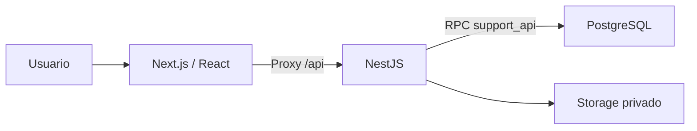

# Arquitectura

Monorepo con frontend Next.js, API NestJS y servicios de PostgreSQL y Storage en Supabase.

## Componentes

| Directorio | Responsabilidad |
|---|---|
| `frontend/app` | Rutas, metadatos y estilos |
| `frontend/components` | Formularios, listado, filtros, imágenes e historial |
| `frontend/lib` | Cliente HTTP, conexión y optimización de imágenes |
| `backend/src` | Controladores, DTOs, servicios y cliente Supabase |
| `backend/test` | Pruebas de API, SQL, imágenes y transporte HTTP |
| `supabase/migrations` | Esquema, permisos, funciones y Storage |

## Datos y transacciones

`support_requests` almacena las solicitudes y sus referencias de imagen. `request_history` conserva eventos, responsables, fechas, observaciones y diferencias de campos.

La función `support_api` valida las reglas y confirma cada operación junto con su historial. Los cambios de estado bloquean la fila mediante `SELECT ... FOR UPDATE`. Un fallo revierte la transacción.

Storage se gestiona fuera de la transacción SQL: primero se sube la imagen y después se confirma su referencia. Si falla la operación SQL, se intenta eliminar el archivo nuevo. Las evidencias confirmadas son inmutables.

## Reglas

- Transiciones: Pendiente → En progreso → Resuelta y Pendiente → Cancelada.
- Las solicitudes cerradas se conservan y no admiten edición ni reapertura.
- Resolver una crítica requiere observación.
- La creación registra al solicitante como responsable; ediciones y cambios de estado requieren `actor`.
- Los filtros se combinan con AND; la búsqueda consulta título, descripción y solicitante.
- La interfaz muestra ocho registros por página; la API admite hasta cien.

## Acceso y despliegue

NestJS valida las entradas mediante DTOs. PostgreSQL aplica restricciones y reglas de negocio. Las tablas tienen RLS y la función RPC se ejecuta con `service_role`. La clave de Supabase permanece en el backend.

La API no autentica usuarios. El nombre del responsable es declarativo; se requiere autenticación y autorización para trabajar con información real.

En desarrollo, NestJS escucha en `127.0.0.1` y el arranque espera su disponibilidad antes de iniciar Next.js. En Vercel, frontend y backend se publican como proyectos separados; `API_URL` configura el proxy entre ambos.
